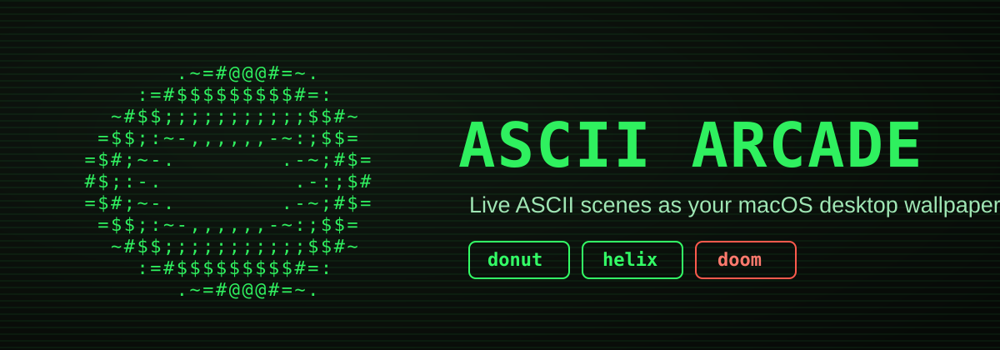
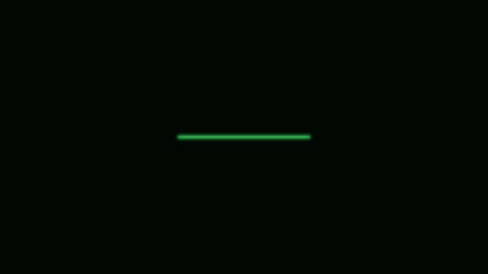
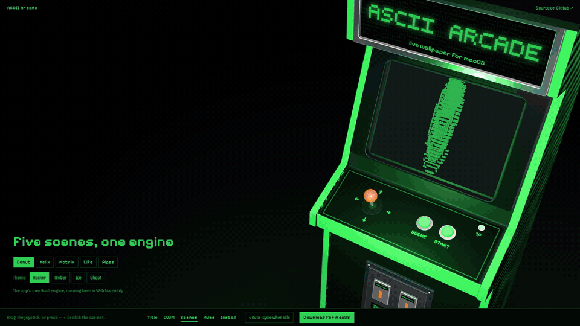
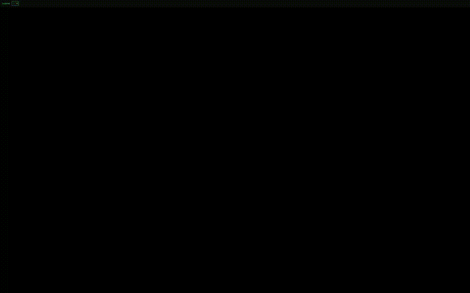
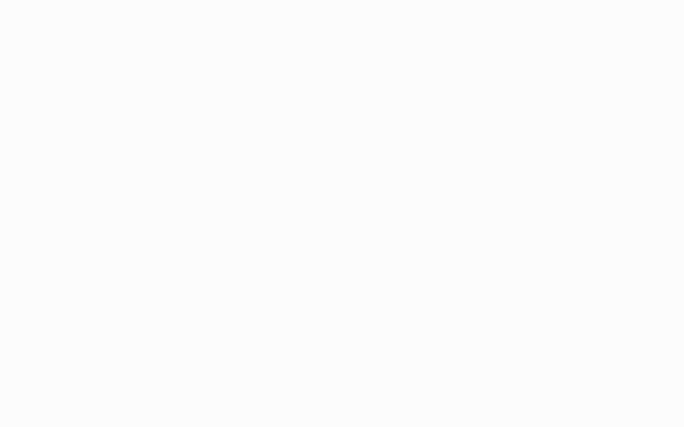
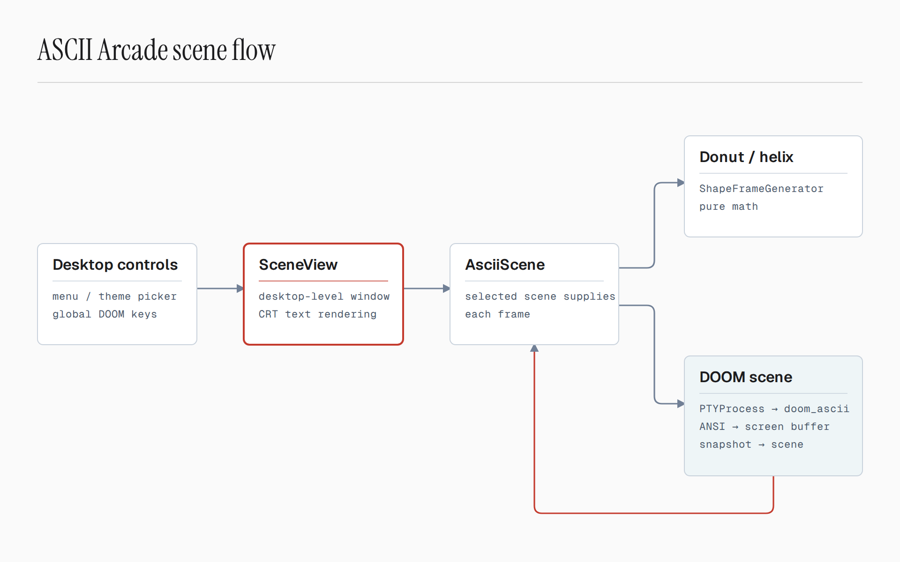

<p align="center">
  <picture>
    <source media="(prefers-color-scheme: dark)"  srcset="assets/banner-dark.svg">
    <source media="(prefers-color-scheme: light)" srcset="assets/banner-light.svg">
    
  </picture>
</p>

<p align="center">
  <a href="https://github.com/Builder106/ascii-arcade/actions/workflows/ci.yml"></a>
  <a href="https://swift.org"></a>
  <a href="https://www.rust-lang.org"></a>
  
  <a href="#license"></a>
</p>

ASCII Arcade turns your Mac's wallpaper into live ASCII art that runs under
all your windows. Matrix rain, a spinning donut, Conway's Life, the old pipes
screensaver, all from the menu bar. You can even switch on DOOM and play it as
your wallpaper. Clicks pass straight through, and when you quit, your old
wallpaper comes back.

Want to see it first? [ascii-arcade-doom.vercel.app](https://ascii-arcade-doom.vercel.app/)
runs the same engine in your browser, on a 3D arcade cabinet you can steer with
the joystick.

## Demo

<details open>
<summary>The site: power-on and attract mode</summary>



</details>

<details>
<summary>The site: scenes and themes on the cabinet</summary>



</details>

<details>
<summary>Donut in the browser terminal</summary>



</details>

<details>
<summary>Matrix rain and the scene picker in the browser terminal</summary>



</details>

There's a [trailer](trailer/) of the site, and a [UI demo](ui-demo/) of the real
Mac app running as the wallpaper, both made in HyperFrames.

## Scenes

| Scene | What it is | Colour | Interactive |
| --- | --- | --- | --- |
| **Donut** | The classic rotating 3D ASCII donut | Theme | No |
| **Helix** | A rotating DNA double helix | Theme | No |
| **Matrix** | Falling code rain with glowing trails | Theme | No |
| **Life** | Conway's Game of Life | Theme | No |
| **Pipes** | The 3D pipes screensaver | Multi-colour | No |
| **DOOM** *(off by default)* | Playable DOOM, drawn in ASCII | Full colour | Yes, keyboard |

Switch scenes and themes from the `◎` menu, or cycle scenes with **⌘⌥C**.

**Themes.** Hacker (green), Amber, Ice and Ghost. DOOM keeps its own colours;
everything else follows the theme, so Matrix rain goes amber under Amber.

**Scene settings.** A few knobs per scene under *Scene Settings*: Matrix speed
and density, Life speed and cell size, Pipes speed and count.

**Auto-cycle when idle.** Leave the Mac alone for about 90 s and it starts
flipping through scenes every 20 s. Touch the keyboard or mouse and it jumps
back to the one you picked. DOOM isn't in the rotation unless you've turned it
on, and nothing renders while the displays are asleep.

**Capture.** ⌘⇧3 and ⌘⇧4 can't see the wallpaper, so use the app's own
shortcuts. **⌘⌥S** saves a PNG to `~/Desktop` and copies it, and **⌘⌥E**
records a 3-second MP4 and opens it in Finder. They're in the menu under
*Capture* too.

## DOOM

DOOM is off by default, since not every screen is the place for a shooter.
Turn on *Enable DOOM Scene* in the menu to get it. With DOOM as the wallpaper
and *Capture keys for DOOM* on, these keys go to the game:

| Action | Key |
| --- | --- |
| Move and turn | Arrow keys |
| Strafe | `,` `.` |
| Fire | Space |
| Use / open | `E` |
| Run | `]` |
| Weapons | `1` to `7` |
| Confirm / menu | Return / Esc |

> Key capture needs **Accessibility** permission (System Settings → Privacy &
> Security → Accessibility). Heads up: while it's on, your keystrokes go to DOOM
> whatever app you're in.

## Install

Download `ASCII-Arcade.dmg` from the
[latest release](https://github.com/Builder106/ascii-arcade/releases/latest).
It sits in your menu bar, remembers your scene, theme and settings, and can
start at login.

1. Open the DMG and drag **ASCII Arcade** onto **Applications**.
2. It isn't notarized, so Gatekeeper blocks the first launch. Control-click the
   app, choose **Open**, then **Open** again, and macOS won't ask after that.
   Or run this in Terminal:

   ```bash
   xattr -dr com.apple.quarantine "/Applications/ASCII Arcade.app"
   ```

3. Find `◎` in your menu bar and pick a scene.

Everything but DOOM works right away. `doom_ascii` is GPL-2.0, so it doesn't
ship in the app; build it with `./scripts/setup.sh` (below). Until you do, the
DOOM scene just shows a hint.

## Build from source (macOS)

You need macOS 13 or later and a Swift 6 toolchain (Xcode 16 or later).

```bash
./scripts/setup.sh        # fetch and build the GPL doom_ascii binary into ./bin
swift build               # build everything
swift run AsciiArcade     # run the wallpaper app
```

The Freedoom IWADs are already in `wad/`, so once `doom_ascii` is built, DOOM
just works.

To package the app yourself:

```bash
./scripts/make-app.sh     # dist/ASCII Arcade.app (release build, icon, WADs)
./scripts/make-dmg.sh     # dist/ASCII-Arcade.dmg
```

`make-app.sh` ad-hoc signs the bundle and includes the Freedoom WADs (BSD). It
skips the GPL `doom_ascii` unless you set `INCLUDE_DOOM=1`, and if you ship
that, you have to ship its source too. Building from iCloud or Google Drive? Set
`SCRATCH_PATH=/tmp/aa-build` or SwiftPM's `build.db` will choke.

## Linux, Windows and the terminal

Everywhere else runs on the Rust port, built around one engine, `aa-core`. The
`aa` binary plays scenes in your terminal and runs the wallpaper on Linux (X11
or wlr-layer-shell) and Windows:

```bash
cargo run -p aa -- play donut                 # in this terminal (q to quit)
cargo run -p aa -- run matrix --theme amber   # as the desktop wallpaper
cargo run -p aa -- scenes                     # list scene ids
cargo run -p aa -- autostart enable           # start at login
```

You can also stream any scene to a browser tab, which is nice for sharing:

```bash
cargo run -p aa-web       # http://127.0.0.1:8788
```

It sends truecolour ANSI frames at 30 fps over a WebSocket to xterm.js. Pick a
scene from the dropdown.

DOOM is locked down harder here. It's not even compiled in without
`--features doom`, and even then `aa scenes`, `aa play` and `aa web` hide it
unless you pass `--enable-doom` (or set `AA_WEB_ENABLE_DOOM=1` for `aa-web`):

```bash
cargo run -p aa --features doom -- play doom --enable-doom
```

`aa run` doesn't do DOOM at all. DOOM as a wallpaper needs bitmap compositing
and global key capture, and so far only the Mac app has those.

## How it works

<picture>
  <source media="(prefers-color-scheme: dark)" srcset="assets/architecture-dark.png">
  
</picture>

You pick a scene and theme in the menu bar, and SceneView draws each frame.
Donut and Helix are just math. DOOM runs `doom_ascii` in a pseudo-terminal,
turns its ANSI output into a character grid, and hands back a snapshot. While
DOOM is up, global key capture feeds it your keys.

On macOS:

- **`AsciiArcadeCore`** has the frame generators, the `AsciiScene` protocol and
  the DOOM glue. `DoomScreenBuffer` parses the ANSI stream, `DoomScene` owns the
  PTY, and `DoomLauncher` finds the binary and IWAD. Colour scenes return a
  `ColoredFrame`, a glyph grid with a matching grid of optional per-cell
  `RGBColor`. Matrix, Life and Pipes share `SteppedScene`, which runs a
  fixed-timestep simulation off the render clock.
- **`PTYBridge`** spawns `doom_ascii` in a pseudo-terminal and pipes its output.
- **`AsciiArcade`** is the AppKit wallpaper host: scene picker, themes, key
  forwarding.
- **`Hotword`** and **`WatcherCLI`**, with `scripts/install_agent.sh`, install a
  LaunchAgent that opens the browser when you type `doom` anywhere.

## Layout

```text
Sources/            macOS app (Swift): AsciiArcadeCore, PTYBridge, AsciiArcade,
                    Hotword, WatcherCLI
Server/             Vapor browser server, its own SwiftPM package
crates/aa-core      Rust engine: scenes, frames, themes, DOOM ANSI buffer
crates/aa-render    software rasteriser from frames to RGBA pixels
crates/aa-doom      DOOM over a portable PTY
crates/aa-ffi       C ABI for the iOS and Android shells
crates/aa-wasm      WebAssembly wrapper for the site
shells/             cli, linux, windows, web, ios, android
site/               the landing page (no build step besides the WASM)
e2e/                Playwright: site specs, demo recordings, footage capture
trailer/, ui-demo/  HyperFrames videos
wad/                Freedoom IWADs
bin/                doom_ascii, built by scripts/setup.sh
```

To redo the README GIFs: `cd e2e && npm run demo` for the terminal ones,
`npm run footage` for the site ones.

## License

GPL-2.0, see [LICENSE](LICENSE). `doom_ascii`
([wojciech-graj/doom-ascii](https://github.com/wojciech-graj/doom-ascii)) is
also GPL-2.0 and is fetched and built by `setup.sh`. The bundled
[Freedoom](https://freedoom.github.io/) IWADs are BSD-licensed.
