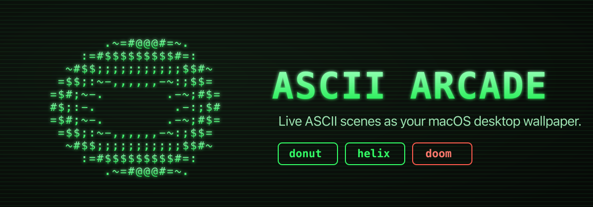

<p align="center">
  <picture>
    <source media="(prefers-color-scheme: dark)"  srcset="assets/banner-dark.png">
    <source media="(prefers-color-scheme: light)" srcset="assets/banner-dark.png">
    
  </picture>
</p>

<p align="center">
  <a href="https://github.com/Builder106/ascii-arcade/actions/workflows/ci.yml"></a>
  <a href="https://swift.org"></a>
  <a href="https://www.rust-lang.org"></a>
  
  
  
  <a href="#license"></a>
</p>

ASCII Arcade runs live ASCII wallpapers on macOS, Windows, and Linux. Choose
Matrix rain, a spinning donut, Conway's Life, or the pipes screensaver. DOOM is
available as an opt-in scene. Each desktop has a controller for choosing scenes
and themes, saving captures, and changing the wallpaper settings.

Want to see it first? [ascii-arcade-doom.vercel.app](https://ascii-arcade-doom.vercel.app/)
runs the same engine in your browser, on a 3D arcade cabinet you can steer with
the joystick.

## Demo

<details open>
<summary>The site: power-on and attract mode</summary>


</details>

<details>
<summary>The site: scenes and themes on the cabinet</summary>


</details>

<details>
<summary>Donut in the browser terminal</summary>


</details>

<details>
<summary>Matrix rain and the scene picker in the browser terminal</summary>


</details>

There's a [trailer](trailer/) of the site, and a [UI demo](ui-demo/) of the real
Mac app running as the wallpaper, both made in HyperFrames.

## Scenes

| Scene | What it is | Colour | Interactive |
| --- | --- | --- | --- |
| **Donut** | The classic rotating 3D ASCII donut | Theme | No |
| **Helix** | A rotating DNA double helix | Theme | No |
| **Matrix** | Falling code rain with glowing trails | Theme | No |
| **Life** | Conway's Game of Life | Theme | No |
| **Pipes** | The 3D pipes screensaver | Multi-colour | No |
| **DOOM** *(off by default)* | Playable DOOM, drawn in ASCII | Full colour | Yes, keyboard |

Switch scenes and themes from the macOS `◎` menu or the Windows and Linux
controllers. On macOS, **⌘⌥C** advances to the next scene.

**Themes.** Hacker (green), Amber, Ice and Ghost. DOOM keeps its own colours;
everything else follows the theme, so Matrix rain goes amber under Amber.

**Scene settings.** Matrix has speed and density controls. Life has speed and
cell size controls. Pipes has speed and pipe count controls.

**Auto-cycle when idle.** After 90 seconds without input, the wallpaper changes
scenes every 20 seconds. The first input restores the scene you chose. DOOM
joins the rotation only after you enable it. Windows and macOS support this
feature; Linux supports it on X11 and GNOME Shell.

**Capture.** The desktop controllers can save a PNG screenshot or a three
second animated clip. Windows and Linux save clips as GIF; macOS saves MP4.
Screenshots copy to the clipboard on Windows and macOS, and on Linux when
`wl-copy` or `xclip` is installed. The macOS menu also has **⌘⌥S** for a
screenshot and **⌘⌥E** for a clip.

## DOOM

DOOM is off by default, since not every screen is the place for a shooter.
Turn on *Enable DOOM Scene* in the menu to get it. With DOOM as the wallpaper
and *Capture keys for DOOM* on, these keys go to the game:

| Action | Key |
| --- | --- |
| Move and turn | Arrow keys |
| Strafe | `,` `.` |
| Fire | Space |
| Use / open | `E` |
| Run | `]` |
| Weapons | `1` to `7` |
| Confirm / menu | Return / Esc |

> macOS asks for **Accessibility** permission in System Settings → Privacy &
> Security → Accessibility. Windows, X11, and GNOME Shell use their native
> session input APIs. While capture is enabled, supported keys also reach DOOM
> as you use other apps.

## Install

Download your platform's package from the
[latest release](https://github.com/Builder106/ascii-arcade/releases/latest):
`ASCII-Arcade.dmg` for macOS, `ASCII-Arcade-v<version>-windows-desktop.zip`
for Windows, or `ASCII-Arcade-v<version>-linux-desktop.tar.gz` for Linux. The
macOS app sits in the menu bar. The Windows and Linux archives include a
controller. All three remember their scene, theme and settings and can start
at login.

1. Open the DMG and drag **ASCII Arcade** onto **Applications**.
2. It isn't notarized, so Gatekeeper blocks the first launch. Control-click the
   app, choose **Open**, then **Open** again, and macOS won't ask after that.
   Or run this in Terminal:

   ```bash
   xattr -dr com.apple.quarantine "/Applications/ASCII Arcade.app"
   ```

3. Find `◎` in your menu bar and pick a scene.

DOOM works as soon as you enable it. The macOS release includes the
`doom_ascii` engine, and its matching GPL-2.0 source archive is available with
the release assets.

## Build from source (macOS)

You need macOS 13 or later and a Swift 6 toolchain (Xcode 16 or later).

```bash
./scripts/setup.sh        # fetch and build the GPL doom_ascii binary into ./bin
swift build               # build everything
swift run AsciiArcade     # run the wallpaper app
```

The Freedoom IWADs are already in `wad/`, so once `doom_ascii` is built, DOOM
just works.

To package the app yourself:

```bash
./scripts/make-app.sh     # dist/ASCII Arcade.app (release build, icon, WADs)
./scripts/make-dmg.sh     # dist/ASCII-Arcade.dmg
```

`make-app.sh` ad-hoc signs the bundle and includes the Freedoom WADs (BSD). It
skips the GPL `doom_ascii` unless you set `INCLUDE_DOOM=1`. Official macOS
releases set this option and include the exact matching upstream source and
license in a separate archive. If you distribute a custom build with DOOM,
include its corresponding source too. Building from iCloud or Google Drive? Set
`SCRATCH_PATH=/tmp/aa-build` or SwiftPM's `build.db` will choke.

## Linux, Windows and the terminal

The desktop archives include a controller for choosing a scene and theme,
starting or stopping the wallpaper, and changing scene settings. They also
offer DOOM opt-in, idle cycling, background opacity, launch at login, screenshots,
and animated clips. Closing a Windows or Linux controller stops the wallpaper
process it started.

- **Windows:** extract the `windows-desktop.zip` archive and open
  `ASCII-Arcade.cmd`. The controller uses Windows PowerShell and Windows Forms.
  If Windows blocks the downloaded script, check `desktop.ps1` Properties for
  **Unblock**. Organization execution policies may require administrator help.
- **Linux:** install your distribution's `zenity` package, extract the
  `linux-desktop.tar.gz` archive, and run `bash install-desktop.sh`. Open
  **ASCII Arcade** from your application menu. Installation is per user and
  needs no root access. You can also run `bash desktop.sh` from the extracted
  folder without installing it.

Linux wallpaper support covers X11 root-pixmap desktops, Wayland compositors
with `wlr-layer-shell`, and GNOME Shell 46 through the bundled extension.
On GNOME, run the installer, log out and back in, then enable **ASCII Arcade**
in the Extensions app. Its top-bar menu has the same scene, theme, DOOM, idle,
capture, and background controls. Scene settings are available in the
controller and the extension menu. The extension currently targets GNOME Shell
46. Desktop managers that cover the X11 root window can hide the wallpaper.
The X11 root-pixmap backend cannot blend transparent pixels. Other Wayland
compositors can render transparent backgrounds, but they do not expose global
idle or keyboard events to wallpaper clients. If you request those controls,
the renderer reports the compositor limitation.

The GNOME extension renders one shared animation across the monitors. It pauses
when locked and stops its renderer when disabled, restoring the regular GNOME
background. It remembers the selected scene and theme. A 640x360 render limit
keeps frame transfer bounded; GNOME scales that image to each monitor.

Everywhere else runs on the Rust port, built around one engine, `aa-core`. The
`aa` binary plays scenes in your terminal and runs the wallpaper on Linux (X11
or wlr-layer-shell) and Windows:

```bash
cargo run -p aa -- play donut                 # in this terminal (q to quit)
cargo run -p aa -- run matrix --theme amber   # as the desktop wallpaper
cargo run -p aa -- scenes                     # list scene ids
cargo run -p aa -- autostart enable           # start at login
```

You can also stream any scene to a browser tab, which is nice for sharing:

```bash
cargo run -p aa-web       # http://127.0.0.1:8788
```

It sends truecolour ANSI frames at 30 fps over a WebSocket to xterm.js. Pick a
scene from the dropdown.

DOOM is off by default. Build with `--features doom`, then pass
`--enable-doom` to make the scene available to `aa scenes`, `aa play`, `aa web`,
or `aa run`:

```bash
cargo run -p aa --features doom -- play doom --enable-doom
cargo run -p aa --features doom -- --enable-doom run doom --capture-keys
```

`--capture-keys` forwards supported keys while DOOM is the active wallpaper.
`--idle-cycle` enables scene rotation after 90 seconds without input. These
options work on Windows and on Linux X11 or GNOME Shell. Other Wayland
compositors do not provide the global input events they need.

## How it works

<picture>
  <source media="(prefers-color-scheme: dark)" srcset="assets/architecture-dark.png">
  
</picture>

You pick a scene and theme in the menu bar, and SceneView draws each frame.
Donut and Helix are just math. DOOM runs `doom_ascii` in a pseudo-terminal,
turns its ANSI output into a character grid, and hands back a snapshot. While
DOOM is up, global key capture feeds it your keys.

On macOS:

- **`AsciiArcadeCore`** has the frame generators, the `AsciiScene` protocol and
  the DOOM glue. `DoomScreenBuffer` parses the ANSI stream, `DoomScene` owns the
  PTY, and `DoomLauncher` finds the binary and IWAD. Colour scenes return a
  `ColoredFrame`, a glyph grid with a matching grid of optional per-cell
  `RGBColor`. Matrix, Life and Pipes share `SteppedScene`, which runs a
  fixed-timestep simulation off the render clock.
- **`PTYBridge`** spawns `doom_ascii` in a pseudo-terminal and pipes its output.
- **`AsciiArcade`** is the AppKit wallpaper host: scene picker, themes, key
  forwarding.
- **`Hotword`** and **`WatcherCLI`**, with `scripts/install_agent.sh`, install a
  LaunchAgent that opens the browser when you type `doom` anywhere.

## Layout

```text
Sources/            macOS app (Swift): AsciiArcadeCore, PTYBridge, AsciiArcade,
                    Hotword, WatcherCLI
Server/             Vapor browser server, its own SwiftPM package
crates/aa-core      Rust engine: scenes, frames, themes, DOOM ANSI buffer
crates/aa-render    software rasteriser from frames to RGBA pixels
crates/aa-doom      DOOM over a portable PTY
crates/aa-ffi       C ABI for the iOS and Android shells
crates/aa-wasm      WebAssembly wrapper for the site
shells/             cli, linux, windows, web, ios, android
site/               the landing page (no build step besides the WASM)
e2e/                Playwright: site specs, demo recordings, footage capture
trailer/, ui-demo/  HyperFrames videos
wad/                Freedoom IWADs
bin/                doom_ascii, built by scripts/setup.sh
```

To redo the README GIFs: `cd e2e && npm run demo` for the terminal ones,
`npm run footage` for the site ones.

## License

GPL-2.0, see [LICENSE](LICENSE). `doom_ascii`
([wojciech-graj/doom-ascii](https://github.com/wojciech-graj/doom-ascii)) is
also GPL-2.0 and is fetched and built by `setup.sh`. The bundled
[Freedoom](https://freedoom.github.io/) IWADs are BSD-licensed.
