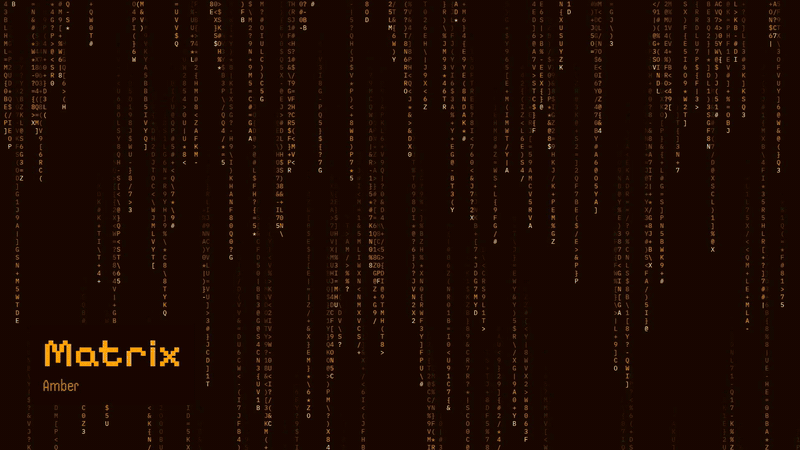

# ASCII Arcade trailer

<p align="center">
  <a href="ascii-arcade-trailer.mp4"></a>
</p>

<p align="center"><a href="ascii-arcade-trailer.mp4"><b>Watch the full trailer (39.5 s, with sound)</b></a></p>

The cabinet plays its own demo like an arcade machine nobody's using:
power-on, the cabinet, the wallpaper under your windows, the scenes, DOOM, and
the snap-back when you come back. Anything on the cabinet or the wall is real
footage of the site; the Mac desktop and the end card are HTML and GSAP.

## How it's made

It's built in HyperFrames. The shot list is in [STORYBOARD.md](STORYBOARD.md).

The clips in `public/clips/` are cut from takes recorded by
`e2e/capture/footage.mjs`. It steps the page on a fake clock and screenshots
every frame, so you get a clean 30 fps take on any machine. To record again
after a site change, build `site/pkg/` and `site/doom-wasm/` first, then:

```console
cd e2e && npm run footage
cd .. && bash scripts/cut-video-clips.sh
```

The cut list for this and the [UI demo](../ui-demo/) lives in
`scripts/cut-video-clips.sh`. To render:

```console
npx --yes hyperframes@0.8.116 check
npx --yes hyperframes@0.8.116 render --quality high --strict -o renders/ascii-arcade-trailer.mp4
```

The full-quality render stays out of git (`renders/` is ignored). The MP4
above is a 720p copy for GitHub.

## Music

"Pixelland" by Kevin MacLeod (CC BY 4.0), in `public/audio.mp3`. Keep the
credit from `public/CREDITS.md` with anything you publish. The sound effects
come from `scripts/video-sfx.py`.
