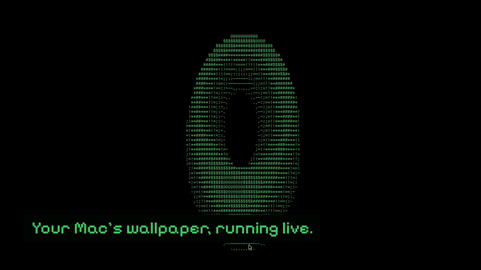

# ASCII Arcade social cut

<p align="center">
  <a href="ascii-arcade-ui-demo.mp4"></a>
</p>

<p align="center"><a href="ascii-arcade-ui-demo.mp4"><b>Watch the full video (29.5 s, with sound)</b></a></p>

A vertical cut of the real site on a phone: the power-on, a tap to take over,
swipes through the stations, scenes and themes repainting the cabinet, and
DOOM.

## How it's made

It's built in HyperFrames from the same footage as the [trailer](../trailer/),
and that README covers recording it again. The shot list is in
[STORYBOARD.md](STORYBOARD.md).

```console
npx --yes hyperframes@0.8.116 check
npx --yes hyperframes@0.8.116 render --quality high --strict -o renders/ascii-arcade-ui-demo.mp4
```

The full-quality render stays out of git (`renders/` is ignored). The MP4
above is a 720p copy for GitHub.

## Music

"Pixel Peeker Polka - faster" by Kevin MacLeod (CC BY 4.0), in
`public/audio.mp3`. Keep the credit from `public/CREDITS.md` with anything you
publish. The sound effects come from `scripts/video-sfx.py`.
